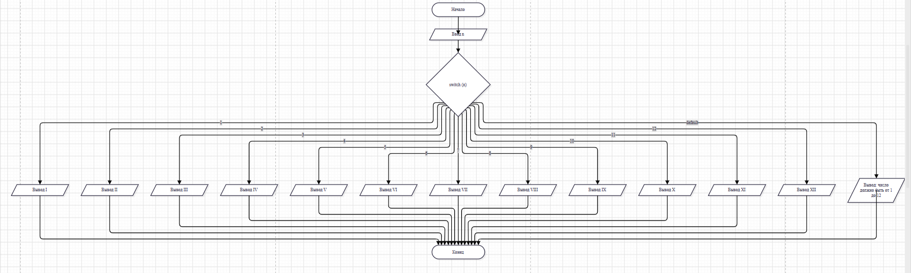

## Домашнее задание к лабораторной 6

### Вариант 11

#### Составить программу, которая для заданного числа от 1 до 12 выводит его отображение римскими числами.

#define _CRT_SECURE_NO_WARNINGS
#include <stdio.h>
#include <locale.h>
int main()
{
    setlocale(LC_ALL, "Russian");

    int n;

    printf("Введите число от 1 до 12: ");
    scanf("%d", &n);

    switch (n)
    {
    case 1:  printf("I\n");    break;
    case 2:  printf("II\n");   break;
    case 3:  printf("III\n");  break;
    case 4:  printf("IV\n");   break;
    case 5:  printf("V\n");    break;
    case 6:  printf("VI\n");   break;
    case 7:  printf("VII\n");  break;
    case 8:  printf("VIII\n"); break;
    case 9:  printf("IX\n");   break;
    case 10: printf("X\n");    break;
    case 11: printf("XI\n");   break;
    case 12: printf("XII\n");  break;
    default: printf("Число должно быть от 1 до 12\n");
    }

    return 0;
}

### Вывод
#### Я изучила оператор `switch` и поняла, что для каждого значения нужен свой `case`, а `break` не даёт программе выполнять следующие варианты. Я сделала программу, которая отличает цифру от буквы, и калькулятор для четырёх действий и возведения в степень. Также я предусмотрела `default` на случай неизвестного символа и защиту от деления на ноль. `switch` удобнее, чем длинная цепочка `if-else`, когда вариантов много.